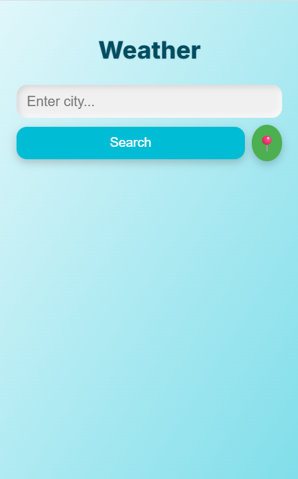

# Weather App

A responsive browser-based weather dashboard built with **HTML, CSS, and vanilla JavaScript**.

[Live demo](https://Artur-Zuiev.github.io/weather-app/) · [Source code](https://github.com/Artur-Zuiev/weather-app)

## Features

- Search for weather by city, with autocomplete suggestions
- Request weather for the current location (with browser permission)
- Display local city time, temperature, humidity, and wind
- Display an upcoming forecast
- Adapt the visual theme to the weather
- Responsive layout for desktop and mobile

## Preview

| Desktop | Mobile |
| --- | --- |
|  |  |

## Tech stack

HTML5 · CSS3 · JavaScript · OpenWeatherMap API · OpenStreetMap Nominatim

## Local development

1. Clone this repository: `git clone https://github.com/Artur-Zuiev/weather-app.git`
2. Open the project folder and serve it using a local web server (for example, VS Code Live Server).
3. Open `index.html` through that server and allow location access if you want geolocation.

**API security note:** This repository's client-side code contains an OpenWeatherMap API key. It should be treated as exposed, revoked/rotated in the provider account, and replaced with a safer approach such as a backend proxy or appropriate key restrictions. Hiding a key in a frontend environment variable is not sufficient.

## Project scope

A personal frontend portfolio project focusing on browser APIs, asynchronous requests, responsive UI, and error handling.

**Created by [Artur Zuiev](https://github.com/Artur-Zuiev).**
